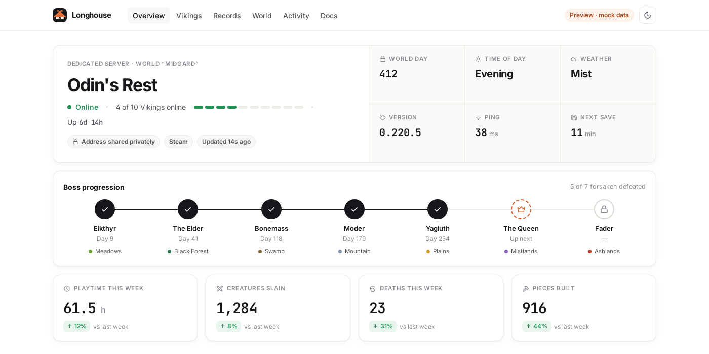
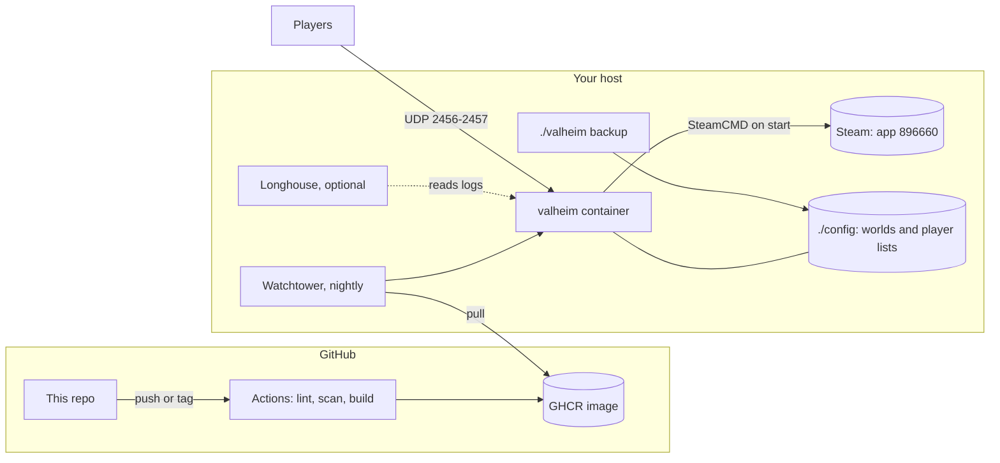

<p align="center">
  
</p>

<h1 align="center">Valheim Game Server</h1>

<p align="center">
  A self-hosted Valheim dedicated server you can set up in five minutes and trust with your world.<br>
  Docker image, one CLI, real backups, no root, no surprises.
</p>

<p align="center">
  <a href="https://mrguato.github.io/valheim-game-server/"><b>Docs</b></a> ·
  <a href="https://github.com/MrGuato/valheim-game-server/pkgs/container/valheim-game-server"><b>Container image</b></a> ·
  <a href="https://github.com/MrGuato/valheim-game-server/releases"><b>Releases</b></a> ·
  <a href="https://github.com/MrGuato/valheim-game-dashboard"><b>Longhouse dashboard</b></a>
</p>

<p align="center">
  <a href="https://github.com/MrGuato/valheim-game-server/releases"></a>
  <a href="https://github.com/MrGuato/valheim-game-server/actions/workflows/build.yml"></a>
  <a href="https://github.com/MrGuato/valheim-game-server/actions/workflows/lint.yml"></a>
  <a href="https://github.com/MrGuato/valheim-game-server/actions/workflows/security.yml"></a>
  <a href="https://github.com/MrGuato/valheim-game-server/actions/workflows/codeql.yml"></a>
  <a href="LICENSE"></a>
  <a href="https://github.com/MrGuato/valheim-game-server/commits/main"></a>
</p>

---

```bash
git clone https://github.com/MrGuato/valheim-game-server.git
cd valheim-game-server
./valheim setup     # asks a few questions, writes .env
./valheim start     # pulls the image, downloads the game, tails the log
```

When the log says `Game server connected`, your friends join with `your.public.ip:2456`. That's it.

## Why this one

There are plenty of ways to run a Valheim server. I built this one because I host a world for my family and friends and wanted something I could stop thinking about. That world (300,000+ objects and counting) runs on this image today, and every feature below is there because I needed it.

**Your world comes first**
- `./valheim stop` and Docker stops send Valheim the signal it saves on, then wait up to two minutes for `World save done` before anything gets killed.
- `./valheim backup` makes a verified tarball of every world and player list with retention, and `./valheim restore` puts one back (it stops the server first so nothing overwrites it).
- Valheim 1.0's chunked save format sometimes creates world folders the server can't read on the next start. The entrypoint repairs their permissions on every start, so you don't come back to an empty new world.
- Bad settings fail loudly before the game starts. Valheim's own password rules (5+ characters, not inside the server name) are checked up front, with a clear message.

**Set it up once, then forget it**
- One CLI for everything: `setup`, `start`, `status`, `logs`, `backup`, `restore`, `update`, `shell`. `make` works too.
- The image only carries SteamCMD. The game is checked and patched on every start, so the image never goes stale when Iron Gate ships an update. A restart is a game update.
- Watchtower checks for a new image once a night at 05:00 and only touches this container.
- Every setting lives in one `.env` file, with a [documented reference](https://mrguato.github.io/valheim-game-server/configuration.html) for presets, modifiers and world keys.

**Safe by default**
- The server runs as an unprivileged user (UID 1000), not root.
- Nothing from GitHub can reach your host: there's no self-hosted runner or deploy hook. Your host pulls a public image, and that's the only connection.
- The image is built in the open by GitHub Actions. Every change goes through hadolint, shellcheck, CodeQL, gitleaks and Trivy (config and image scans), and Dependabot keeps base images and actions current.
- The optional BepInEx mod loader is baked into the image at a pinned version with a SHA-256 check, so a server start never downloads and runs code from the internet.
- Versioned releases (`IMAGE_TAG=2.0.0`) let you pin exactly what you run.

### Compared with the usual options

|                                   | This repo | Manual SteamCMD + systemd | Rented game host |
| --------------------------------- | :-------: | :-----------------------: | :--------------: |
| Five-minute setup                 | ✅ | ❌ | ✅ |
| You own the world files           | ✅ | ✅ | depends |
| Game patches on restart           | ✅ | manual | ✅ |
| Saves the world on shutdown       | ✅ | if you script it | ✅ |
| Backups with restore              | ✅ one command | DIY | usually |
| Runs as non-root                  | ✅ | if you set it up | n/a |
| Server-side mods (BepInEx)        | ✅ opt-in | manual | some |
| Live web dashboard                | ✅ [Longhouse](#pair-it-with-longhouse) | ❌ | basic panel |
| Monthly cost                      | your hardware | your hardware | a monthly fee |

This repo stays small on purpose, so you can read all of it in an evening and know what runs on your machine.

## Pair it with Longhouse

<p align="center">
  <a href="https://mrguato.github.io/valheim-game-dashboard/"></a>
</p>

[**Longhouse**](https://github.com/MrGuato/valheim-game-dashboard) is my web dashboard for Valheim servers, kept in its own repo. It shows who's online, the in-game day, boss progress, leaderboards, a "when do we play" heatmap and armory-style player profiles. [Try the demo](https://mrguato.github.io/valheim-game-dashboard/) (mock data).

The two are separate projects, and neither needs the other. They're built to fit together:

- Longhouse runs as its own container next to this one. It reads the server log through a read-only Docker socket proxy and never touches your world files.
- Set `BEPINEX=true` here and drop the Longhouse server plugin into `config/bepinex/plugins/` to add character figures, gear, biomes, kills per creature and pieces built.
- The plugin goes on the server only. Players install nothing, so it can't affect their Steam achievements.

Setup steps: [Dashboard (Longhouse)](https://mrguato.github.io/valheim-game-server/dashboard.html).

## Everyday commands

```bash
./valheim status       # container, health, game version, players in the last log sample
./valheim logs         # follow the log
./valheim restart      # save, restart, pick up game patches
./valheim update       # pull the newest image and recreate
./valheim backup       # verified tarball of worlds and player lists into ./backups
./valheim restore FILE # put a backup back
./valheim stop         # save the world and stop
./valheim shell        # shell inside the container
./valheim help         # everything else
```

## How it fits together



## Requirements

| Component      | Minimum |
| -------------- | ------- |
| OS             | Ubuntu 22.04+ or Debian 12+ (any Linux with Docker should work) |
| Docker         | 24.x or newer, with Compose v2 |
| CPU            | 2 cores. Valheim leans on one thread, so clock speed matters more than core count |
| RAM            | 4 GB, 8 GB for 5+ players or big worlds |
| Disk           | 6 GB free |
| Network        | UDP 2456-2457 forwarded (2458 too for crossplay) |

## Documentation

The full guide is at **[mrguato.github.io/valheim-game-server](https://mrguato.github.io/valheim-game-server/)**:

- [Installation](https://mrguato.github.io/valheim-game-server/installation.html): fresh Ubuntu host to first login
- [Configuration](https://mrguato.github.io/valheim-game-server/configuration.html): every variable, presets, modifiers, player lists
- [Updates](https://mrguato.github.io/valheim-game-server/updates.html): game patches, image updates, pinning a release
- [Backups](https://mrguato.github.io/valheim-game-server/backups.html): local, scheduled, off-host, restore
- [Mods (BepInEx)](https://mrguato.github.io/valheim-game-server/mods.html): server-side plugins without breaking achievements
- [Dashboard (Longhouse)](https://mrguato.github.io/valheim-game-server/dashboard.html): the companion web dashboard
- [Security](https://mrguato.github.io/valheim-game-server/security.html) and [Troubleshooting](https://mrguato.github.io/valheim-game-server/troubleshooting.html)

## What's in the repo

```
valheim-game-server/
+-- valheim                  The CLI (run this)
+-- Dockerfile               Ubuntu 22.04 + SteamCMD + pinned BepInEx pack
+-- docker-compose.yaml      The server (image from GHCR) + Watchtower
+-- docker-compose.dev.yml   Override for local builds
+-- docker-entrypoint.sh     Starts as root: fixes volume ownership, drops to PUID/PGID
+-- entrypoint.sh            Validates settings, updates the game, starts it, saves on stop
+-- healthcheck.sh           Container health probe
+-- scripts/backup.sh        Verified tarballs with retention
+-- scripts/restore.sh       Restore from a tarball
+-- docs/                    The documentation site (just-the-docs)
+-- .github/workflows/       Build and publish, lint, security scans, CodeQL
```

Only infrastructure code lives here: no game files, worlds, server addresses or secrets. `.env` is gitignored.

## Releases and versioning

`latest` follows `main`. Tagged releases (`2.0.0`, `2.0`) stay put, so set `IMAGE_TAG=2.0.0` to pin one and update when you choose. What changed in each release is in the [CHANGELOG](CHANGELOG.md) and on the [releases page](https://github.com/MrGuato/valheim-game-server/releases).

## Contributing and security

Issues and pull requests are welcome. For a security problem, please follow [SECURITY.md](SECURITY.md) instead of opening a public issue.

## License

[MIT](LICENSE). Valheim is a trademark of Iron Gate AB. This project isn't affiliated with Iron Gate or Coffee Stain; it downloads the official dedicated server from Steam at runtime and doesn't redistribute any game files.

See you in the Viking lands!
