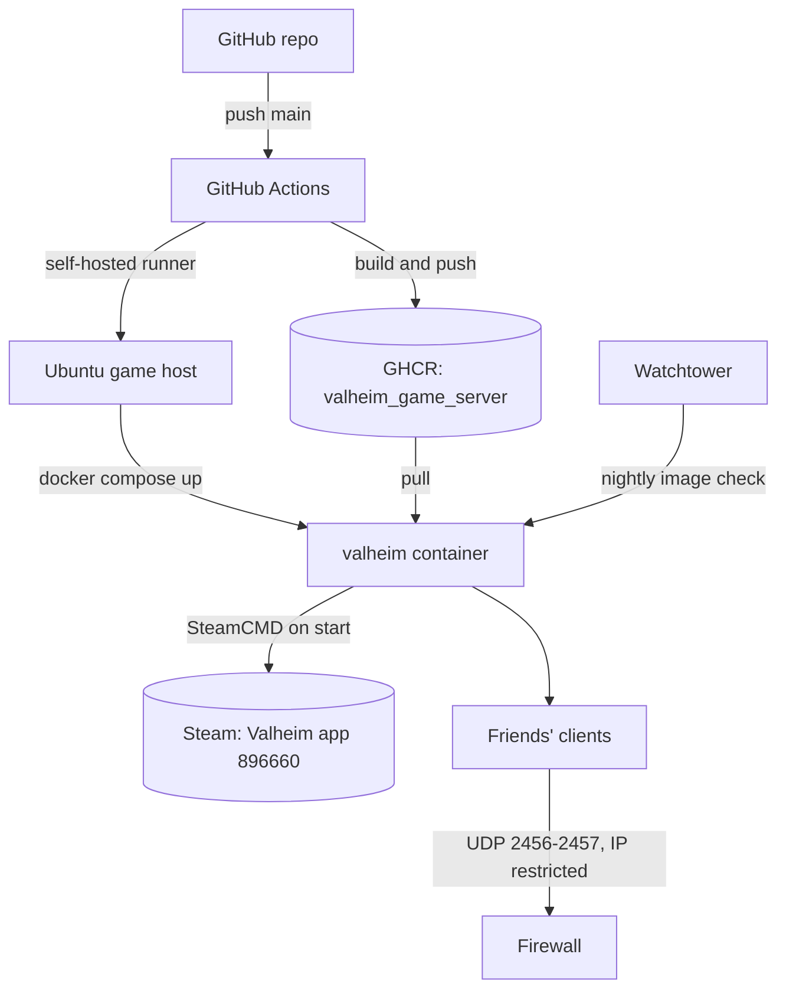

[](https://github.com/MrGuato)
[](https://github.com/MrGuato/Valheim_Game_Server/actions/workflows/build.yml)
[](https://github.com/MrGuato/Valheim_Game_Server/actions/workflows/lint.yml)
[](https://github.com/MrGuato/Valheim_Game_Server/actions/workflows/deploy.yml)
[](https://github.com/MrGuato/Valheim_Game_Server/actions/workflows/codeql.yml)
[](https://github.com/MrGuato/Valheim_Game_Server/actions/workflows/pages/pages-build-deployment)
[](https://github.com/MrGuato/Valheim_Game_Server/pkgs/container/valheim_game_server)
[](https://snyk.io/test/github/MrGuato/Valheim_Game_Server)

[]()

# Valheim Dedicated Server

Self-hosted Valheim dedicated server for Linux. Docker image built on Ubuntu 22.04 with SteamCMD, configured entirely through `.env`, with persistent worlds, healthchecks, backups and a single CLI for everything. The repo also deploys itself to the game host from GitHub Actions.

Full guide: [mrguato.github.io/Valheim_Game_Server](https://mrguato.github.io/Valheim_Game_Server/)

## Why this exists

I wanted to show how a gaming project can double as a practical DevOps and DevSecOps case study. Hosting Valheim this way demonstrates:

- **Infrastructure as Code**: the server can be rebuilt consistently anywhere from this repo
- **Immutable image, moving game**: the image only ships SteamCMD. The game files are fetched and validated on every container start, so the image never goes stale between Valheim patches
- **Security first**: `.env` stays out of git, the server runs as an unprivileged user, the firewall restricts access to trusted IPs, and every change goes through hadolint, shellcheck, CodeQL and Trivy-style scanning
- **Automation and CI/CD**: GitHub Actions builds and publishes the image to GHCR and deploys the stack to the host through a self-hosted runner; Watchtower keeps the running image fresh
- **Resilience**: worlds are backed up with retention and can be restored in one command

This repository holds infrastructure code only. No game files, worlds or secrets are committed.

## Architecture



## Requirements

| Component      | Minimum |
| -------------- | ------- |
| OS             | Ubuntu 22.04+ or Debian 12+ |
| Docker         | 24.x or newer |
| Docker Compose | v2 (`docker compose`) |
| RAM            | 4 GB (8 GB recommended for 5+ players) |
| Disk           | 6 GB free |
| Network        | UDP 2456-2457 forwarded (2458 for crossplay) |

## Quick start

```bash
git clone https://github.com/MrGuato/Valheim_Game_Server.git
cd Valheim_Game_Server
chmod +x valheim
./valheim setup
./valheim start
```

`setup` writes a `.env` and creates the data folders. `start` pulls the image, launches the container and tails the logs. The first boot downloads about 2.2 GB of game files via SteamCMD. When you see `Game server connected`, players can join with `your.public.ip:2456`.

## Common operations

```bash
./valheim status       # container, health, server info, last known player count
./valheim logs         # tail logs
./valheim restart      # save the world and restart (also picks up game patches)
./valheim update       # pull the latest image and recreate
./valheim backup       # snapshot worlds and player lists to ./backups
./valheim restore FILE # restore a backup tarball
./valheim stop         # save the world and stop
./valheim down         # remove the containers (data persists)
./valheim shell        # bash inside the container
./valheim help         # full command list
```

`make` works too (`make start`, `make logs`, ...).

## Configuration

Everything lives in `.env`. Edit it, then recreate the container:

```bash
nano .env
./valheim update
```

Variable reference: [Configuration](https://mrguato.github.io/Valheim_Game_Server/configuration.html). The variable names match `lloesche/valheim-server`, so an existing `.env` keeps working, and `IMAGE_REPOSITORY` lets you run either image with the same compose file. See [Migrating from lloesche](https://mrguato.github.io/Valheim_Game_Server/migration.html).

## Updates

Game patches: `./valheim restart` (SteamCMD validates and updates on every start).
Image: `./valheim update`, or let Watchtower do it nightly at 05:00. Details: [Updates](https://mrguato.github.io/Valheim_Game_Server/updates.html).

## Backups

```bash
./valheim backup
```

Writes a timestamped tarball to `./backups/` and prunes anything older than 14 days. Schedule it with cron:

```cron
30 9 * * 0 cd /home/game_server/Valheim_Game_Server && ./valheim backup >> logs/backup.log 2>&1
```

Then push the tarballs off the host (rsync, S3, restic). Restore with `./valheim restore ./backups/valheim-2026-10-15-0930.tar.gz`. Details: [Backups](https://mrguato.github.io/Valheim_Game_Server/backups.html).

## Deploying from GitHub

`.github/workflows/deploy.yml` runs on a self-hosted runner on the game host for every push to `main` (documentation-only changes are skipped). It executes a deploy script that resets the checkout to `origin/main`, pulls images and runs `docker compose up -d`. Secrets never leave the host: `.env` is gitignored and survives the reset.

## Local builds

The default config pulls the prebuilt image from GHCR. To build from source:

```bash
./valheim build
IMAGE_REPOSITORY=valheim_game_server IMAGE_TAG=dev ./valheim start
```

## Layout

```
Valheim_Game_Server/
+-- valheim                  CLI wrapper (run this)
+-- Dockerfile               Ubuntu 22.04 + SteamCMD
+-- docker-compose.yaml      Production compose (image from GHCR) + Watchtower
+-- docker-compose.dev.yml   Override for local builds
+-- docker-entrypoint.sh     Root: PUID/PGID, volume ownership, drop privileges
+-- entrypoint.sh            Runtime: validation, SteamCMD update, server start, save on stop
+-- healthcheck.sh           Container health probe
+-- Makefile                 Thin wrapper around ./valheim
+-- .env.example             Copy to .env via ./valheim setup
+-- scripts/
|   +-- backup.sh            Tarball worlds and player lists with retention
|   +-- restore.sh           Restore from a backup tarball
+-- docs/                    GitHub Pages site (just-the-docs)
+-- .github/workflows/       Build and publish to GHCR, hadolint + shellcheck, CodeQL, deploy
+-- config/                  Worlds and player lists (created on first run)
+-- data/                    Game files from SteamCMD (created on first run)
+-- backups/                 Backup tarballs
```

See you in the Viking lands!
