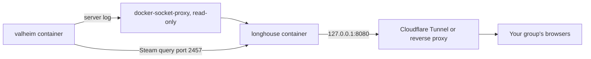

# Dashboard (Longhouse)

[Longhouse](https://github.com/MrGuato/valheim-game-dashboard) is a web dashboard for a Valheim server: who's online, the in-game day and time, boss progress, leaderboards, a "when do we play" heatmap, an activity feed, and armory-style player profiles with a drawn character and their gear.

[](https://mrguato.github.io/valheim-game-dashboard/)

[Open the demo](https://mrguato.github.io/valheim-game-dashboard/){: .btn .btn-primary .mr-2 }
[Longhouse on GitHub](https://github.com/MrGuato/valheim-game-dashboard){: .btn }

It's a **separate project** with its own repo, image, releases and docs. This server runs fine without it, and Longhouse also works with `lloesche/valheim-server`. This page covers how the two fit together. For everything else, see the [Longhouse docs](https://mrguato.github.io/valheim-game-dashboard/docs.html).

## How they connect



- Longhouse reads the Valheim container's log through a read-only Docker socket proxy and asks the server's Steam query port for live status. It never mounts or writes your world.
- It listens only on `127.0.0.1:8080`. Put a Cloudflare Tunnel (with Access) or a reverse proxy in front of it, so you don't need to forward another port.
- Its container carries the Watchtower label, so the Watchtower from this repo keeps it updated too.

## 1. Run Longhouse next to the server

On the same host:

```bash
git clone https://github.com/MrGuato/valheim-game-dashboard.git
cd valheim-game-dashboard/deploy
cp .env.example .env
```

In its `.env`, match this server:

```ini
VALHEIM_CONTAINER=valheim        # CONTAINER_NAME from this repo's .env
VALHEIM_QUERY_PORT=2457          # QUERY_PORT from this repo's .env
```

```bash
docker compose up -d
```

Open `http://127.0.0.1:8080` on the host (or through an SSH tunnel). You'll see status, players, sessions, deaths and the heatmap right away.

## 2. Optional: the server plugin

The Longhouse server plugin adds each online player's character figure, visible gear, biome and health, plus kills per creature and building pieces per player. It's a BepInEx plugin that runs **on the server only**, so players install nothing and their achievements aren't affected (see [Mods]({{ '/mods.html' | relative_url }})).

1. Turn on BepInEx in this repo's `.env` and recreate the container:
   ```ini
   BEPINEX=true
   ```
   ```bash
   ./valheim update
   ```
2. Build `Longhouse.Server.dll` as described in the [plugin README](https://github.com/MrGuato/valheim-game-dashboard/tree/main/mods).
3. Stop the server, copy the plugin in, start it again:
   ```bash
   ./valheim stop
   cp Longhouse.Server.dll config/bepinex/plugins/
   ./valheim start
   ```
4. Once the world has loaded, `./valheim logs` shows a line like `LH1 {"t":"hello","plugin":"0.3.1"}`, and the character figures on the dashboard fill in.

To update the plugin, repeat step 3. Always stop the server first: replacing the DLL while it runs can crash the server later (see [Mods]({{ '/mods.html' | relative_url }}#add-or-update-a-plugin)).

## Privacy

Longhouse hashes Steam IDs before storing anything and never shows the server address. With `LONGHOUSE_PASSWORD`, or Cloudflare Access in front of it, only your group can open it.
